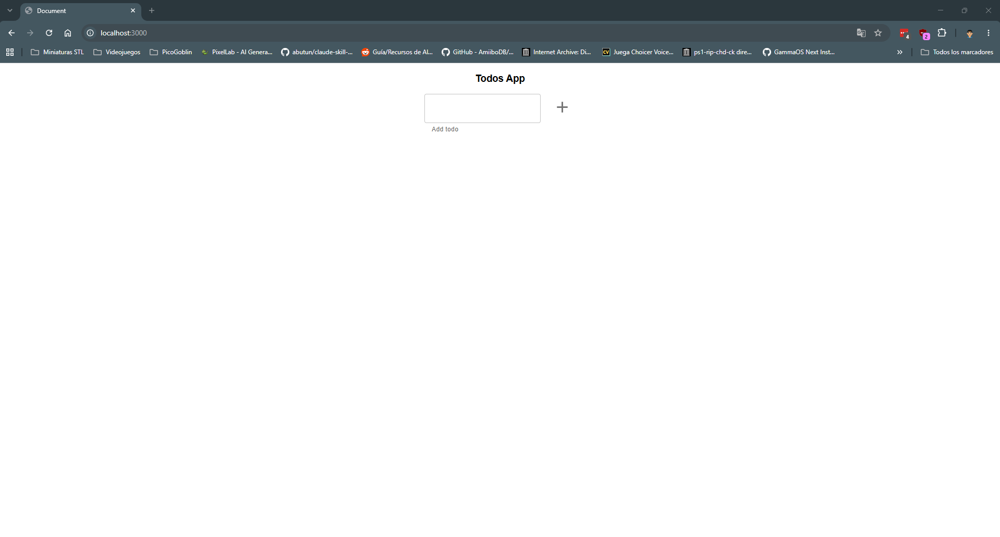
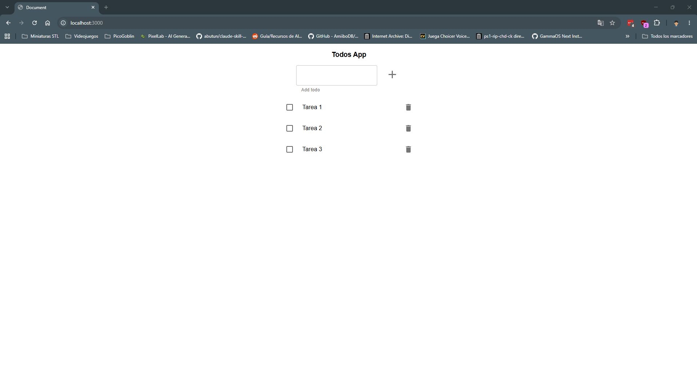
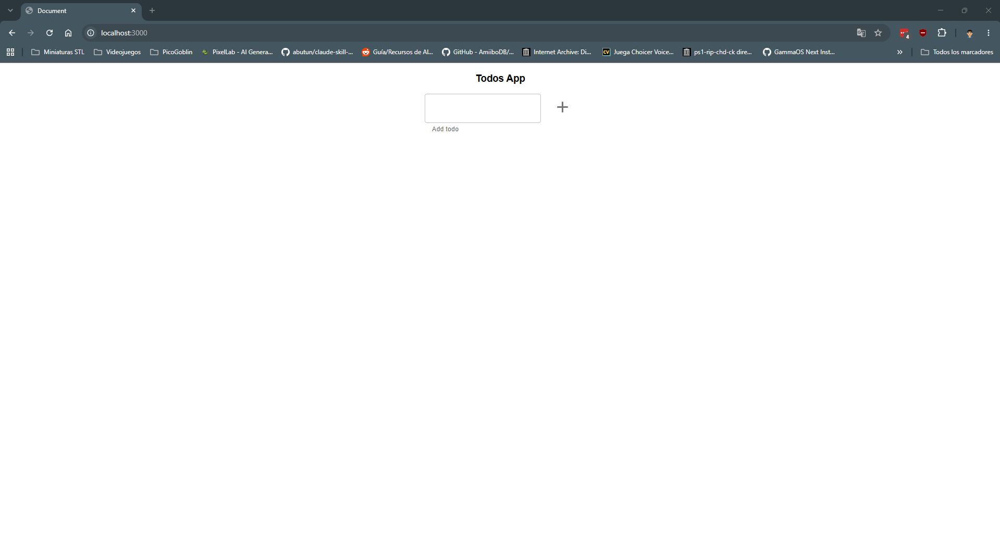
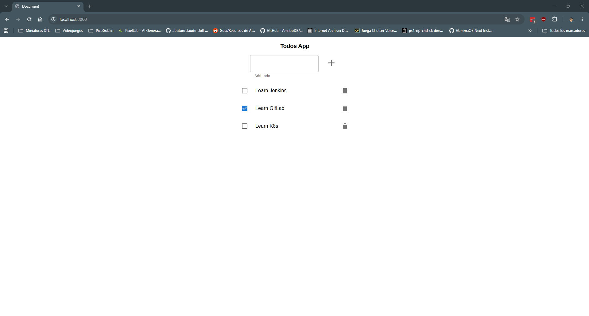
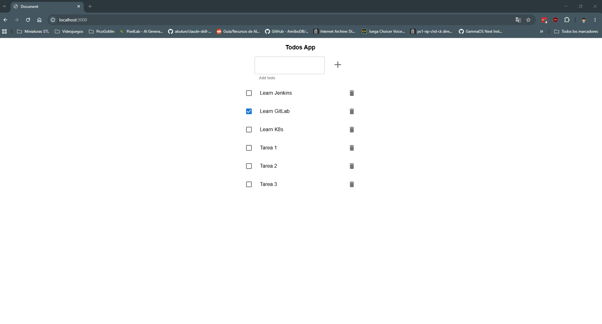
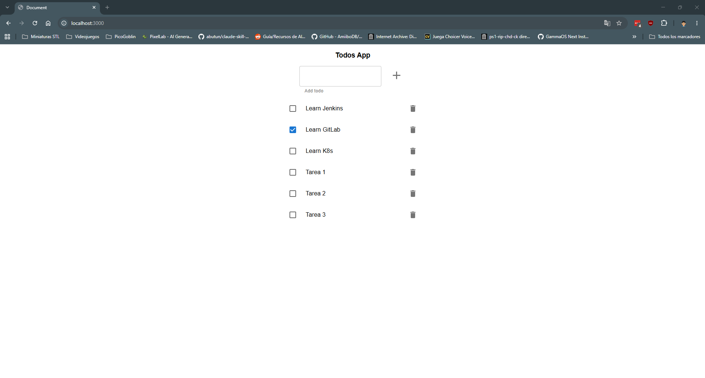
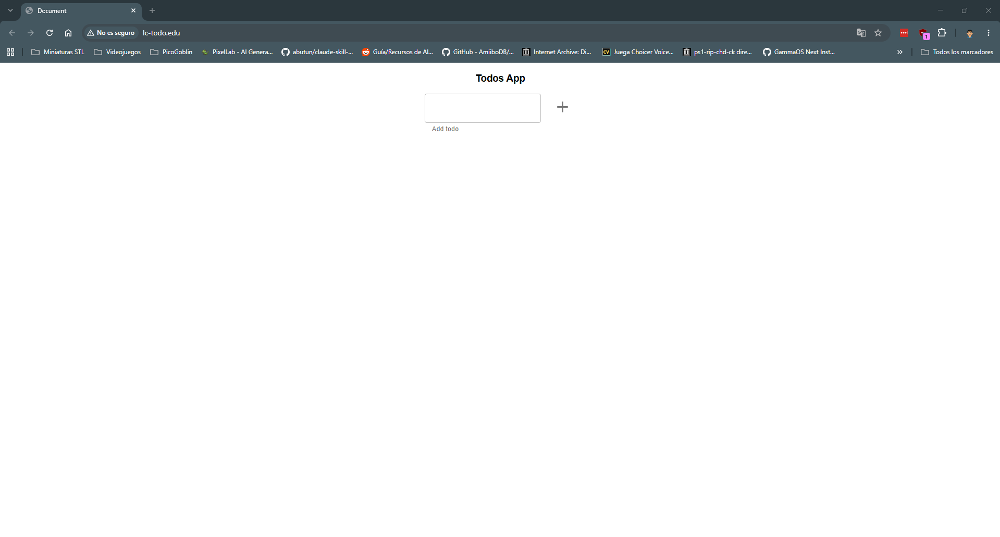
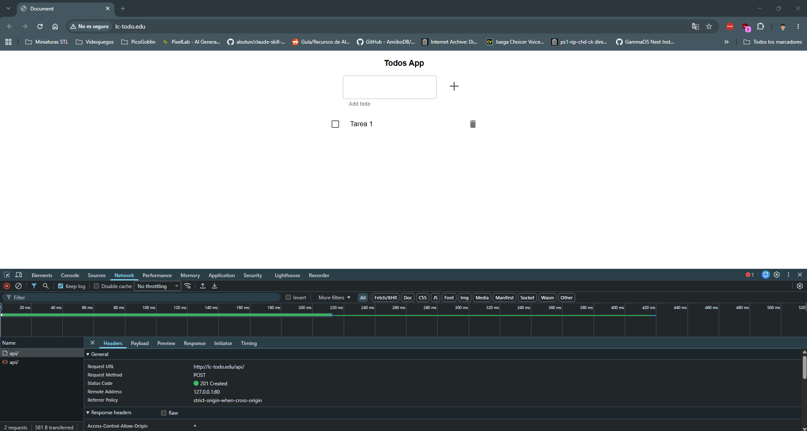
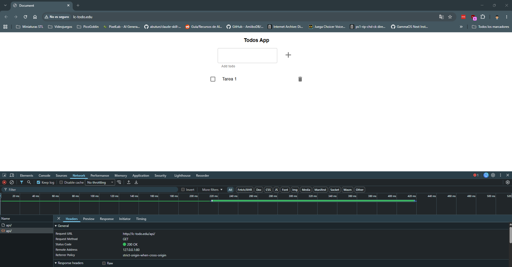

# 🧭 Laboratorio Orquestación

## Pre-requisitos para ejecutar las aplicaciones en local

- Docker
- node 22.* >

## Ejercicio 1. Monolito en memoria

Se trata de una aplicación web que expone una aplicación de UI (la típica aplicación TODO), y una API para gestionar en servidor los 'TODOS'. La persistencia de los TODOS es en memoria, eso significa que cuando apaguemos la aplicación dejarán de persistir los datos.

### 📋 Requisitos

- [x] Construir la imagen de `todo-app` a partir del `Dockerfile` en `00-monolith-in-mem/todo-app`.
- [x] Crear un `Deployment` para `todo-app` (variables de entorno `NODE_ENV` y `PORT`).
- [x] Crear un `LoadBalancer Service` para acceder a `todo-app` desde fuera del clúster.

### 🛠️ Resolución

Solución

Levanto el clúster con minikube:

```bash
minikube start --driver=docker
kubectl get nodes
```
```
NAME       STATUS   ROLES           AGE   VERSION
minikube   Ready    control-plane   68s   v1.37.0
```

Al principio me salía `NotReady`, pero al minuto más o menos pasa a `Ready` solo.

Imagen de `todo-app`:

```bash
cd 02-orquestacion/exercises/00-monolith-in-mem/todo-app
docker build -t todo-app:v1 .
minikube image load todo-app:v1
minikube image ls | grep todo-app
```
```
docker.io/library/todo-app:v1
```

El `image load` es necesario porque minikube no ve las imágenes de mi Docker local. Le pongo tag `v1` y no `latest`, si no Kubernetes intenta bajarla de Docker Hub.

`ejercicio-1/deployment.yaml`:
```yaml
apiVersion: apps/v1
kind: Deployment
metadata:
  name: todo-app
spec:
  replicas: 1
  selector:
    matchLabels:
      app: todo-app
  template:
    metadata:
      labels:
        app: todo-app
    spec:
      containers:
        - name: todo-app
          image: todo-app:v1
          imagePullPolicy: IfNotPresent
          ports:
            - containerPort: 3000
          env:
            - name: NODE_ENV
              value: production
            - name: PORT
              value: "3000"
```

```bash
kubectl apply -f ejercicio-1/deployment.yaml
kubectl get deploy,pods
kubectl logs deploy/todo-app
```
```
NAME                       READY   UP-TO-DATE   AVAILABLE   AGE
deployment.apps/todo-app   1/1     1            1           6s

NAME                            READY   STATUS    RESTARTS   AGE
pod/todo-app-574586659c-xptw8   1/1     Running   0          6s

Server running on port 3000
```

`ejercicio-1/service.yaml`:
```yaml
apiVersion: v1
kind: Service
metadata:
  name: todo-app
spec:
  type: LoadBalancer
  selector:
    app: todo-app
  ports:
    - port: 3000
      targetPort: 3000
```

```bash
kubectl apply -f ejercicio-1/service.yaml
kubectl get svc todo-app
```
```
NAME       TYPE           CLUSTER-IP      EXTERNAL-IP   PORT(S)          AGE
todo-app   LoadBalancer   10.110.125.41   <pending>     3000:32753/TCP   10s
```

Se queda en `<pending>` porque minikube no tiene balanceador como en la nube. Con `minikube tunnel` en otra terminal ya le asigna IP:

```
NAME       TYPE           CLUSTER-IP      EXTERNAL-IP   PORT(S)          AGE
todo-app   LoadBalancer   10.110.125.41   127.0.0.1     3000:32753/TCP   72s
```

La app responde en `http://localhost:3000`.



Para comprobar que los datos van en memoria creo unas tareas, borro el pod y recargo:

```bash
kubectl delete pod -l app=todo-app
kubectl get pods
```
```
NAME                        READY   STATUS    RESTARTS   AGE
todo-app-574586659c-r5hkq   1/1     Running   0          40s
```

El Deployment levanta un pod nuevo y las tareas ya no están.




---

## Ejercicio 2. Monolito

Se trata de la misma aplicación pero en este caso la persistencia en memoria se hace a través de una base de datos.

### 📋 Requisitos

- [x] Crear la capa de persistencia: `ConfigMap`, `StorageClass`, `PersistentVolume`, `PersistentVolumeClaim`, `Cluster IP Service` y `StatefulSet` de PostgreSQL.
- [x] Sembrar la base de datos (`todo-app/todos_db.sql`) si no se usa la imagen ya "cocinada".
- [x] Crear un `Deployment` para `todo-app` con las variables de entorno de conexión a BD vía `ConfigMap`.
- [x] Crear un `LoadBalancer Service` para acceder a `todo-app` desde fuera del clúster.

### 🛠️ Resolución

Solución

Quito lo del ejercicio 1 y construyo las dos imágenes, la de la app y la de la BD "cocinada" (`postgres:16` con el `todos_db.sql` en `docker-entrypoint-initdb.d`, así no hay que hacer el seed a mano):

```bash
kubectl delete -f ejercicio-1/

cd 02-orquestacion/exercises/01-monolith/todo-app
docker build -t todo-app-db:v1 .
docker build -f Dockerfile.todos_db -t todo-db:v1 .
minikube image load todo-app-db:v1
minikube image load todo-db:v1
```

Capa de persistencia:

`ejercicio-2/db-configmap.yaml`:
```yaml
apiVersion: v1
kind: ConfigMap
metadata:
  name: todo-db-config
data:
  # POSTGRES_DB: todos_db 
  POSTGRES_USER: postgres
  POSTGRES_PASSWORD: postgres
```

`ejercicio-2/db-storage.yaml`:
```yaml
apiVersion: storage.k8s.io/v1
kind: StorageClass
metadata:
  name: todo-db-sc
provisioner: k8s.io/minikube-hostpath
reclaimPolicy: Retain
---
apiVersion: v1
kind: PersistentVolume
metadata:
  name: todo-db-pv
spec:
  storageClassName: todo-db-sc
  capacity:
    storage: 1Gi
  accessModes:
    - ReadWriteOnce
  hostPath:
    path: /data/todo-db
---
apiVersion: v1
kind: PersistentVolumeClaim
metadata:
  name: todo-db-pvc
spec:
  storageClassName: todo-db-sc
  accessModes:
    - ReadWriteOnce
  resources:
    requests:
      storage: 1Gi
```

`ejercicio-2/db-statefulset.yaml`:
```yaml
apiVersion: v1
kind: Service
metadata:
  name: todo-db
spec:
  type: ClusterIP
  selector:
    app: todo-db
  ports:
    - port: 5432
      targetPort: 5432
---
apiVersion: apps/v1
kind: StatefulSet
metadata:
  name: todo-db
spec:
  serviceName: todo-db
  replicas: 1
  selector:
    matchLabels:
      app: todo-db
  template:
    metadata:
      labels:
        app: todo-db
    spec:
      containers:
        - name: postgres
          image: todo-db:v1
          imagePullPolicy: IfNotPresent
          ports:
            - containerPort: 5432
          envFrom:
            - configMapRef:
                name: todo-db-config
          volumeMounts:
            - name: data
              mountPath: /var/lib/postgresql/data
      volumes:
        - name: data
          persistentVolumeClaim:
            claimName: todo-db-pvc
```

```bash
kubectl apply -f ejercicio-2/db-configmap.yaml
kubectl apply -f ejercicio-2/db-storage.yaml
kubectl apply -f ejercicio-2/db-statefulset.yaml
kubectl get pv,pvc
```
```
NAME                          CAPACITY   ACCESS MODES   RECLAIM POLICY   STATUS   CLAIM                 STORAGECLASS
persistentvolume/todo-db-pv   1Gi        RWO            Retain           Bound    default/todo-db-pvc   todo-db-sc

NAME                                STATUS   VOLUME       CAPACITY   ACCESS MODES   STORAGECLASS
persistentvolumeclaim/todo-db-pvc   Bound    todo-db-pv   1Gi        RWO            todo-db-sc
```

La primera vez tenía puesto `POSTGRES_DB: todos_db` en el ConfigMap y el pod salía `Running` pero con un reinicio. Mirando los logs del contenedor anterior:

```bash
kubectl logs todo-db-0 --previous
```
```
CREATE DATABASE
/usr/local/bin/docker-entrypoint.sh: running /docker-entrypoint-initdb.d/todos_db.sql
...
psql:/docker-entrypoint-initdb.d/todos_db.sql:40: ERROR:  database "todos_db" already exists
```

Postgres crea `todos_db` por la variable y luego el script también hace `CREATE DATABASE todos_db`, así que falla. Al reiniciar ya no vuelve a lanzar el script porque el volumen tiene datos (`Skipping initialization`), y la BD se queda vacía:

```bash
kubectl exec todo-db-0 -- psql -U postgres -d todos_db -c "\dt"
```
```
Did not find any relations.
```

Comento la variable, borro el StatefulSet y vacío el volumen en el nodo para que vuelva a inicializar:

```bash
kubectl delete -f ejercicio-2/db-statefulset.yaml
minikube ssh "sudo rm -rf /data/todo-db"
kubectl apply -f ejercicio-2/db-configmap.yaml
kubectl apply -f ejercicio-2/db-statefulset.yaml
kubectl exec todo-db-0 -- psql -U postgres -d todos_db -c "\dt"
```
```
              List of relations
 Schema |      Name       | Type  |  Owner   
--------+-----------------+-------+----------
 public | migrations      | table | postgres
 public | migrations_lock | table | postgres
 public | todos           | table | postgres
(3 rows)
```

Ahora sí.

La app. `DB_HOST` es el nombre del Service de la BD, igual que en el compose del módulo 02 usaba `mongo`:

`ejercicio-2/app-configmap.yaml`:
```yaml
apiVersion: v1
kind: ConfigMap
metadata:
  name: todo-app-config
data:
  NODE_ENV: production
  PORT: "3000"
  DB_HOST: todo-db
  DB_USER: postgres
  DB_PASSWORD: postgres
  DB_PORT: "5432"
  DB_NAME: todos_db
  DB_VERSION: "10.4"
```

`ejercicio-2/app.yaml`:
```yaml
apiVersion: apps/v1
kind: Deployment
metadata:
  name: todo-app
spec:
  replicas: 1
  selector:
    matchLabels:
      app: todo-app
  template:
    metadata:
      labels:
        app: todo-app
    spec:
      containers:
        - name: todo-app
          image: todo-app-db:v1
          imagePullPolicy: IfNotPresent
          ports:
            - containerPort: 3000
          envFrom:
            - configMapRef:
                name: todo-app-config
---
apiVersion: v1
kind: Service
metadata:
  name: todo-app
spec:
  type: LoadBalancer
  selector:
    app: todo-app
  ports:
    - port: 3000
      targetPort: 3000
```

```bash
kubectl apply -f ejercicio-2/app-configmap.yaml
kubectl apply -f ejercicio-2/app.yaml
kubectl get pods,svc
```
```
NAME                            READY   STATUS    RESTARTS   AGE
pod/todo-app-66b5444d6d-4pr42   1/1     Running   0          4s
pod/todo-db-0                   1/1     Running   0          5m6s

NAME                 TYPE           CLUSTER-IP      EXTERNAL-IP   PORT(S)          AGE
service/kubernetes   ClusterIP      10.96.0.1       <none>        443/TCP          38m
service/todo-app     LoadBalancer   10.107.170.69   <pending>     3000:30458/TCP   4s
service/todo-db      ClusterIP      10.96.229.65    <none>        5432/TCP         5m6s
```

Con `minikube tunnel` otra vez, en `http://localhost:3000` ya salen las tareas que trae el seed:



Añado unas tareas y esta vez borro los dos pods, la app y la BD:

```bash
kubectl delete pod -l app=todo-app
kubectl delete pod todo-db-0
kubectl get pods
```
```
NAME                            READY   STATUS    RESTARTS   AGE
pod/todo-app-66b5444d6d-267pc   1/1     Running   0          46s
pod/todo-db-0                   1/1     Running   0          12s
```

Al recargar las tareas siguen ahí, porque ahora están en el volumen y no en la memoria del pod.




---

## Ejercicio 3. Aplicación Distribuida (Ingress)

Se trata de dos aplicaciones, una UI expuesta a través de un `nginx` y una `API` que corre sobre `express/nodejs` y se conecta con una base de datos `postgres`.

### 📋 Requisitos

- [x] Crear `Deployment` y `Cluster IP Service` para `todo-front`.
- [x] Crear `Deployment` y `Cluster IP Service` para `todo-api` (variables `NODE_ENV`, `PORT`, opcionalmente vía `ConfigMap`).
- [x] Crear un `Ingress` que exponga ambos servicios (referencia: [Ingress en Minikube con NGINX Ingress Controller](https://kubernetes.io/docs/tasks/access-application-cluster/ingress-minikube/)).

### 🛠️ Resolución

Solución

Quito lo del ejercicio 2 y construyo las dos imágenes. El front sin `--build-arg API_HOST`, así llama a `/api/` en el mismo host y el Ingress se encarga de repartir:

```bash
kubectl delete -f ejercicio-2/

cd 02-orquestacion/exercises/02-distributed
docker build -t todo-api:v1 ./todo-api
docker build -t todo-front:v1 ./todo-front
minikube image load todo-api:v1
minikube image load todo-front:v1
```

`ejercicio-3/front.yaml`:
```yaml
apiVersion: apps/v1
kind: Deployment
metadata:
  name: todo-front
spec:
  replicas: 1
  selector:
    matchLabels:
      app: todo-front
  template:
    metadata:
      labels:
        app: todo-front
    spec:
      containers:
        - name: todo-front
          image: todo-front:v1
          imagePullPolicy: IfNotPresent
          ports:
            - containerPort: 80
---
apiVersion: v1
kind: Service
metadata:
  name: todo-front
spec:
  type: ClusterIP
  selector:
    app: todo-front
  ports:
    - port: 80
      targetPort: 80
```

`ejercicio-3/api.yaml`:
```yaml
apiVersion: v1
kind: ConfigMap
metadata:
  name: todo-api-config
data:
  NODE_ENV: production
  PORT: "3000"
---
apiVersion: apps/v1
kind: Deployment
metadata:
  name: todo-api
spec:
  replicas: 1
  selector:
    matchLabels:
      app: todo-api
  template:
    metadata:
      labels:
        app: todo-api
    spec:
      containers:
        - name: todo-api
          image: todo-api:v1
          imagePullPolicy: IfNotPresent
          ports:
            - containerPort: 3000
          envFrom:
            - configMapRef:
                name: todo-api-config
---
apiVersion: v1
kind: Service
metadata:
  name: todo-api
spec:
  type: ClusterIP
  selector:
    app: todo-api
  ports:
    - port: 3000
      targetPort: 3000
```

```bash
kubectl apply -f ejercicio-3/front.yaml
kubectl apply -f ejercicio-3/api.yaml
kubectl get pods,svc
```
```
NAME                              READY   STATUS    RESTARTS   AGE
pod/todo-api-788b9cc985-hm9s5     1/1     Running   0          4s
pod/todo-front-5cd97bb59b-ch6qf   1/1     Running   0          11s

NAME                 TYPE        CLUSTER-IP       EXTERNAL-IP   PORT(S)    AGE
service/kubernetes   ClusterIP   10.96.0.1        <none>        443/TCP    49m
service/todo-api     ClusterIP   10.108.111.210   <none>        3000/TCP   4s
service/todo-front   ClusterIP   10.102.202.225   <none>        80/TCP     11s
```

Los dos son ClusterIP, desde fuera no se llega. Pruebo desde dentro del pod de la API:

```bash
kubectl exec deploy/todo-api -- sh -c "wget -qO- http://todo-front | head -c 300; echo; echo ---; wget -qO- http://todo-api:3000/api/"
```
```
<!doctype html><html lang="en"><head><meta charset="UTF-8"><meta name="viewport" content="width=device-width,initial-scale=1"><title>Document</title>...
---
[]
```

Para el Ingress primero hay que activar el controlador en minikube:

```bash
minikube addons enable ingress
kubectl get pods -n ingress-nginx
```

`ejercicio-3/ingress.yaml`:
```yaml
apiVersion: networking.k8s.io/v1
kind: Ingress
metadata:
  name: todo-ingress
spec:
  ingressClassName: nginx
  rules:
    - host: lc-todo.edu
      http:
        paths:
          - path: /api
            pathType: Prefix
            backend:
              service:
                name: todo-api
                port:
                  number: 3000
          - path: /
            pathType: Prefix
            backend:
              service:
                name: todo-front
                port:
                  number: 80
```

Sin `rewrite-target`, porque la API ya tiene sus rutas en `/api/` y tiene que recibirlas tal cual.

```bash
kubectl apply -f ejercicio-3/ingress.yaml
kubectl get ingress
```
```
NAME           CLASS   HOSTS         ADDRESS        PORTS   AGE
todo-ingress   nginx   lc-todo.edu   192.168.49.2   80      56s
```

Siguiendo la doc de Kubernetes probé contra `minikube ip` y nada:

```bash
curl.exe -m 10 --resolve "lc-todo.edu:80:192.168.49.2" http://lc-todo.edu/api/
```
```
curl: (28) Connection timed out after 10007 milliseconds
```

En Windows con el driver de Docker esa IP está dentro de la red de Docker y no se llega desde fuera. Igual que con el LoadBalancer, hace falta `minikube tunnel` (el propio addon lo avisa al activarlo) y entonces responde en `127.0.0.1`:

```bash
curl.exe --resolve "lc-todo.edu:80:127.0.0.1" http://lc-todo.edu/api/
curl.exe --resolve "lc-todo.edu:80:127.0.0.1" http://lc-todo.edu/
```
```
[]
<!doctype html><html lang="en"><head><meta charset="UTF-8">...<title>Document</title>...
```

Para el navegador añado el host en `C:\Windows\System32\drivers\etc\hosts`:

```
127.0.0.1 lc-todo.edu
```

Y con el tunnel abierto, `http://lc-todo.edu` funciona. En la pestaña Network se ve que el `POST` y el `GET` van a `lc-todo.edu/api/`, el mismo host que la página, y el Ingress los manda a la API.




