# 🔁 Laboratorio CI/CD

Para superar el módulo hay que entregar como mínimo:

- Los ejercicios de Jenkins.
- La parte obligatoria de los ejercicios de GitHub Actions.
- Uno de los dos ejercicios opcionales de la parte de GitHub Actions.

De los opcionales elijo el **Ejercicio 3** (tests e2e).

## Ejercicios Jenkins

### Ejercicio 1. CI/CD de una Java + Gradle

En el directorio raíz del código fuente (`jenkins-resources/calculator`), crear un `Jenkinsfile` que contenga una pipeline declarativa. Para ejecutar Jenkins en local con las dependencias necesarias se puede construir una imagen a partir de `jenkins-resources/gradle.Dockerfile`.

#### 📋 Requisitos

- [x] **Checkout**. Descarga de código desde un repositorio remoto, preferentemente GitHub.
- [x] **Compile**. Compilar el código fuente con `gradlew compileJava`.
- [x] **Unit Tests**. Ejecutar los test unitarios con `gradlew test`.

#### 🛠️ Resolución

Solución

Copio la calculadora en este repo, en `04-ci-cd/jenkins/calculator`, y el `Jenkinsfile` va en su raíz como pide el enunciado. Como el proyecto no está en la raíz del repo, después del checkout tengo que entrar en su carpeta con `dir`, si no `./gradlew` no se encuentra.

`04-ci-cd/jenkins/calculator/Jenkinsfile`:
```groovy
pipeline {
    agent any
    stages {
        stage('Checkout') {
            steps {
                git url: 'https://github.com/adanoliva/bootcamp-devops.git', branch: 'main'
            }
        }
        stage('Compile') {
            steps {
                dir('04-ci-cd/jenkins/calculator') {
                    sh './gradlew compileJava'
                }
            }
        }
        stage('Unit Tests') {
            steps {
                dir('04-ci-cd/jenkins/calculator') {
                    sh './gradlew test'
                }
            }
        }
    }
}
```

Levanto Jenkins con la imagen del curso, que añade Gradle 6.6.1 a `jenkins/jenkins:lts-jdk11`:

```bash
cd 03-cd/exercises/jenkins-resources
docker build -t jenkins-gradle -f gradle.Dockerfile .
docker run -d --name jenkins -p 8080:8080 -p 50000:50000 -v jenkins_home:/var/jenkins_home jenkins-gradle
docker exec jenkins cat /var/jenkins_home/secrets/initialAdminPassword
```

Al desbloquear Jenkins y darle a "Install suggested plugins" fallan todos, incluidos Pipeline y Git, que son los que necesito:

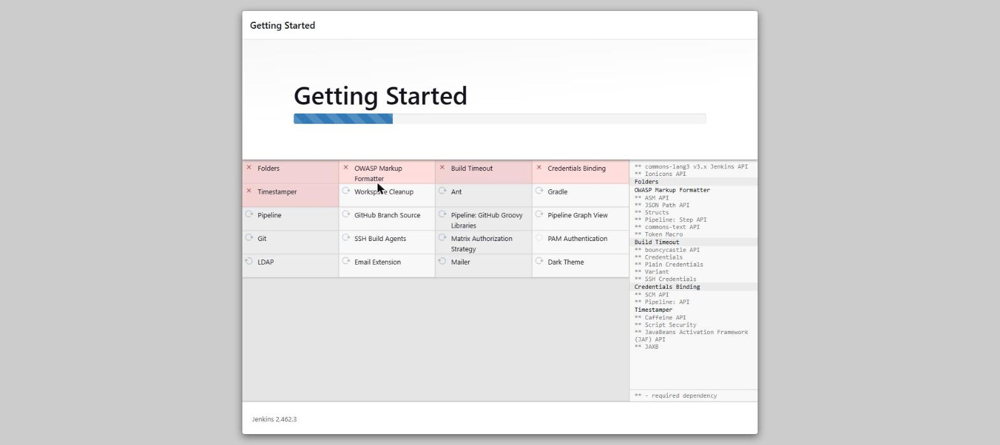
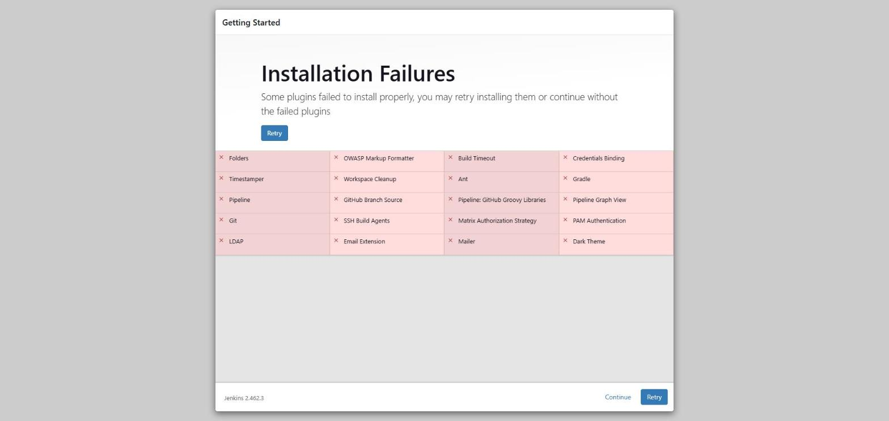

En los logs del contenedor se ve el motivo:

```bash
docker logs jenkins
```
```
Failed to install commons-lang3-api
 - Jenkins (2.479.3) or higher required
Failed to install ionicons-api
 - Jenkins (2.504.1) or higher required
Failed to install cloudbees-folder
 - Failed to load: Ionicons API (ionicons-api 94.vcc3065403257)
 - Jenkins (2.504.1) or higher required
```

La imagen `lts-jdk11` se quedó congelada en Jenkins 2.462.3 (la última versión con Java 11), pero el asistente baja la última versión de cada plugin y esas piden 2.479 o más. Como unos plugins dependen de otros, van cayendo todos en cadena. Hay que actualizar el Dockerfile del curso a una imagen de Jenkins más nueva.

Cambio la primera línea del `gradle.Dockerfile`:

```dockerfile
FROM jenkins/jenkins:lts-jdk17
```

Borro el contenedor y el volumen, porque `jenkins_home` ya tenía el asistente a medias con los plugins rotos, y vuelvo a construir:

```bash
docker rm -f jenkins
docker volume rm jenkins_home
docker build -t jenkins-gradle -f gradle.Dockerfile .
docker run -d --name jenkins -p 8080:8080 -p 50000:50000 -v jenkins_home:/var/jenkins_home jenkins-gradle
```

Ahora levanta Jenkins 2.541.3 y los plugins se instalan sin problema:

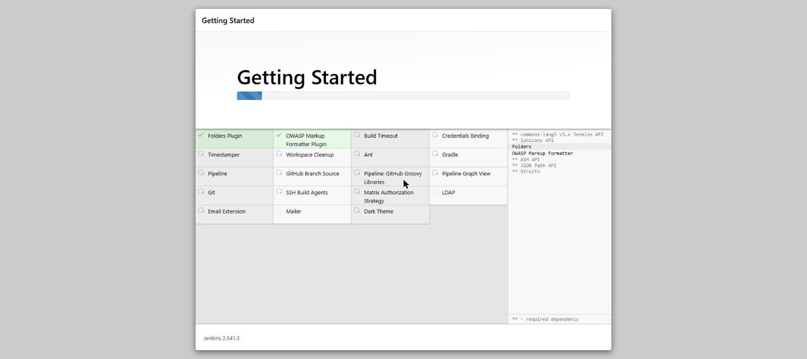
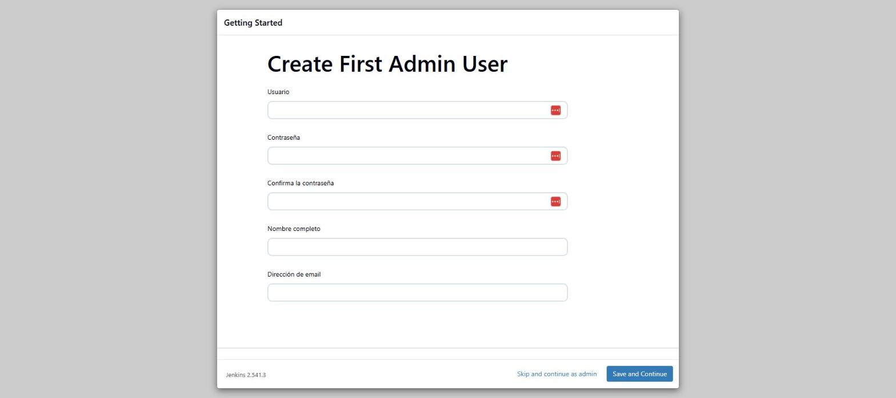

Creo el usuario admin, dejo la URL en `http://localhost:8080/` y ya tengo Jenkins funcionando:


Creo el job `Calculator` de tipo Pipeline, con el Jenkinsfile sacado del repo (Pipeline script from SCM), rama `*/main` y Script Path `04-ci-cd/jenkins/calculator/Jenkinsfile`. No necesita credenciales porque el repo es público:

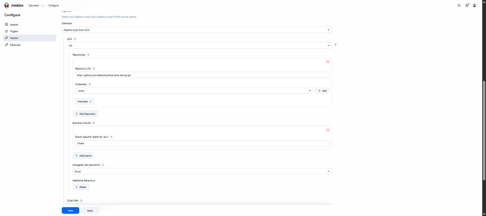

Lanzo el primer build y falla:

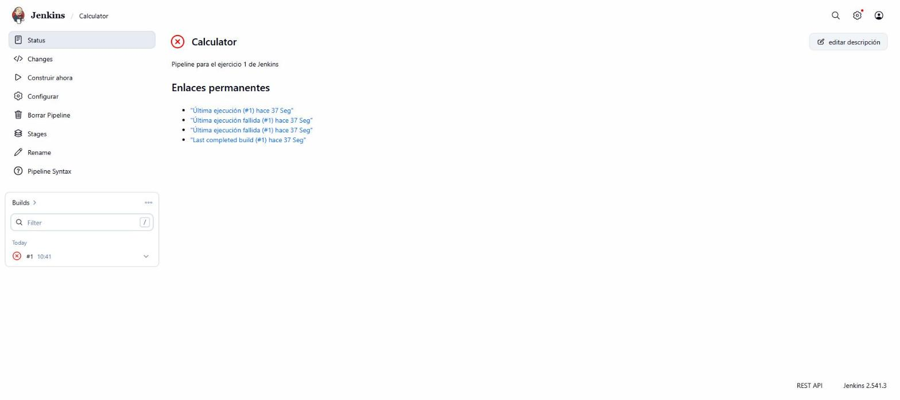

En el Console Output, el checkout va bien pero el stage Compile no puede ejecutar `gradlew`:

```
Running in /var/jenkins_home/workspace/Calculator/04-ci-cd/jenkins/calculator
+ ./gradlew compileJava
.../script.sh.copy: 1: ./gradlew: Permission denied
Stage "Unit Tests" skipped due to earlier failure(s)
ERROR: script returned exit code 126
Finished: FAILURE
```

El `gradlew` se subió desde Windows y git lo guardó sin permiso de ejecución (`100644`), así que al clonarlo en Jenkins (Linux) no se puede ejecutar. Se lo doy en el índice de git, para que quede como `100755` en el repo (este error lo encontré y lo solucioné con ayuda de la IA, que al final es un recurso más):

```bash
git update-index --chmod=+x 04-ci-cd/jenkins/calculator/gradlew
```

El build #2 ya ejecuta `gradlew`, pero vuelve a fallar:

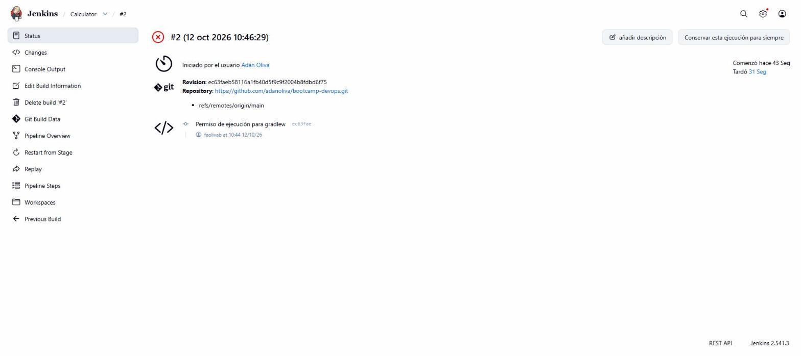

```
Could not compile settings file '.../calculator/settings.gradle'.
> startup failed:
  General error during semantic analysis: Unsupported class file major version 61
```

La versión 61 es Java 17, la de la imagen nueva de Jenkins, y Gradle 6.6.1 no la soporta. Para no tocar el proyecto, añado un JDK 11 a la imagen y hago que el build lo use con `JAVA_HOME`, mientras Jenkins sigue con su Java 17.

En el `gradle.Dockerfile`, debajo del `FROM`, copio el JDK de la imagen oficial de Temurin 11:

```dockerfile
FROM jenkins/jenkins:lts-jdk17

COPY --from=eclipse-temurin:11-jdk /opt/java/openjdk /opt/java/jdk11
```

Y en el `Jenkinsfile` añado el `environment`, que solo afecta a los steps de la pipeline:

```groovy
pipeline {
    agent any
    environment {
        JAVA_HOME = '/opt/java/jdk11'
    }
    stages {
        ...
```

Reconstruyo la imagen y recreo el contenedor, esta vez sin borrar el volumen para no perder los plugins, el usuario ni el job:

```bash
docker build -t jenkins-gradle -f gradle.Dockerfile .
docker rm -f jenkins
docker run -d --name jenkins -p 8080:8080 -p 50000:50000 -v jenkins_home:/var/jenkins_home jenkins-gradle
```

El build #3 ya sale en verde, con los tres stages:

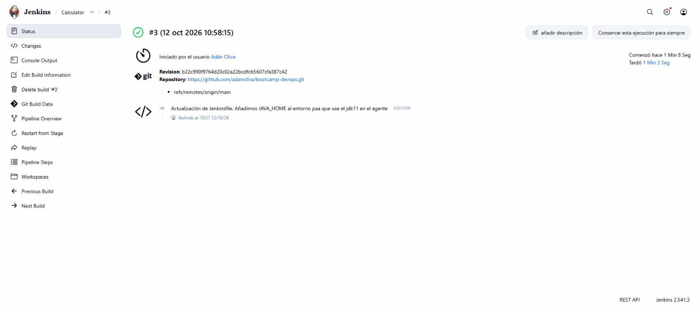

```
+ ./gradlew compileJava
> Task :compileJava
BUILD SUCCESSFUL in 45s
+ ./gradlew test
> Task :compileJava UP-TO-DATE
> Task :compileTestJava
> Task :test
BUILD SUCCESSFUL in 8s
Finished: SUCCESS
```

En el test no vuelve a compilar (`UP-TO-DATE`) porque ya lo hizo el stage anterior.

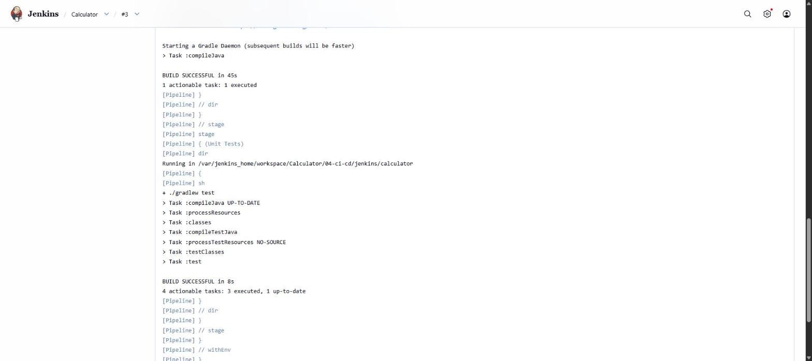

---

### Ejercicio 2. Usar la imagen Docker de Gradle como build runner

Modificar la pipeline anterior para que utilice la imagen Docker de Gradle como build runner.

#### 📋 Requisitos

- [x] Levantar Jenkins con Docker in Docker.
- [x] Tener instalados los plugins `Docker` y `Docker Pipeline`.
- [x] Usar la imagen `gradle:6.6.1-jre14-openj9`.

#### 🛠️ Resolución

Solución

En el ejercicio 1 el build dependía de lo que tuviera instalado Jenkins, y por eso tuve que meter un JDK 11 a mano. Con la imagen de Gradle como agente el build corre dentro de un contenedor que ya trae su Java y su Gradle, y a Jenkins solo le hace falta poder lanzar contenedores.

Para eso uso el montaje del curso (`03-cd/01-jenkins/00-instalando-jenkins`), un `docker-compose.yml` con dos servicios:

- `docker`: la imagen `docker:dind` en modo `privileged`, un demonio Docker propio donde se crearán los contenedores de los builds.
- `jenkins`: Jenkins `lts-jdk17` con el cliente de Docker instalado, que se conecta al demonio anterior con `DOCKER_HOST=tcp://docker:2376` y los certificados TLS que comparten por el volumen `docker_certs`.

Los dos montan el mismo `jenkins_home`, porque el contenedor de Gradle lo crea el demonio de DinD y tiene que poder montar el workspace del job.

Paro el Jenkins del ejercicio 1, que ocupa el puerto 8080, y levanto el nuevo:

```bash
docker stop jenkins
cd 03-cd/01-jenkins/00-instalando-jenkins
docker compose up -d --build
docker exec jenkins-blueocean cat /var/jenkins_home/secrets/initialAdminPassword
```

Compruebo que el cliente de Docker de Jenkins habla con el demonio de DinD y no con el de mi máquina:

```bash
docker exec jenkins-blueocean docker version --format '{{.Client.Version}} -> {{.Server.Version}}'
```
```
29.9.0 -> 29.9.0
```

Desbloqueo Jenkins, instalo los plugins sugeridos y creo el usuario admin:

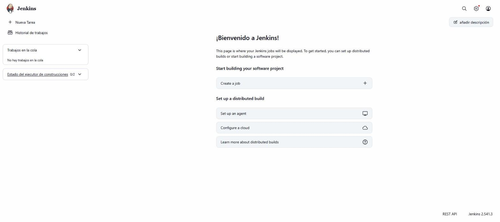

La imagen del curso ya trae `Docker Pipeline` (`docker-workflow`), pero el plugin `Docker` no viene ni en la imagen ni en los sugeridos, así que lo instalo desde Plugins → Available plugins:

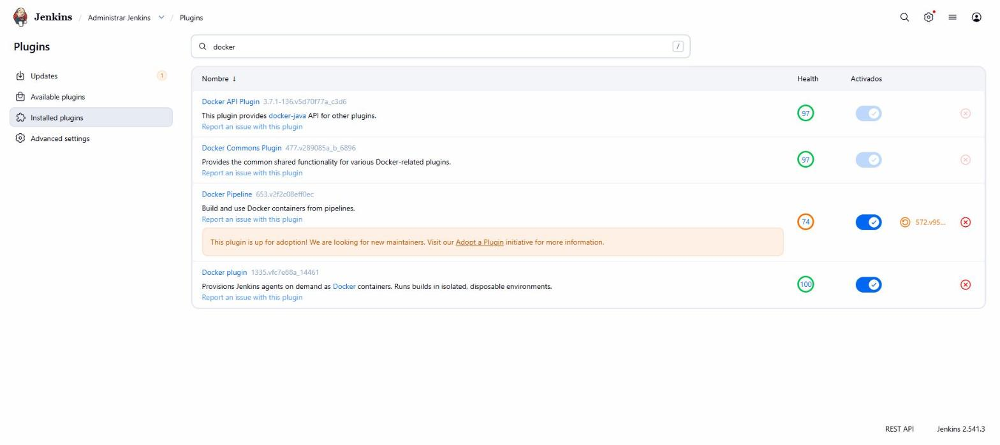

Para no romper el job del ejercicio 1, la pipeline nueva va en otro fichero, `04-ci-cd/jenkins/calculator/Jenkinsfile.docker`. Los stages son los mismos; cambia el `agent` y sobra el `environment` con `JAVA_HOME`:

```groovy
pipeline {
    agent {
        docker {
            image 'gradle:6.6.1-jre14-openj9'
        }
    }
    stages {
        stage('Checkout') {
            steps {
                git url: 'https://github.com/adanoliva/bootcamp-devops.git', branch: 'main'
            }
        }
        stage('Compile') {
            steps {
                dir('04-ci-cd/jenkins/calculator') {
                    sh './gradlew compileJava'
                }
            }
        }
        stage('Unit Tests') {
            steps {
                dir('04-ci-cd/jenkins/calculator') {
                    sh './gradlew test'
                }
            }
        }
    }
}
```

Creo el job `Calculator` en este Jenkins igual que en el ejercicio 1, cambiando el Script Path a `04-ci-cd/jenkins/calculator/Jenkinsfile.docker`:

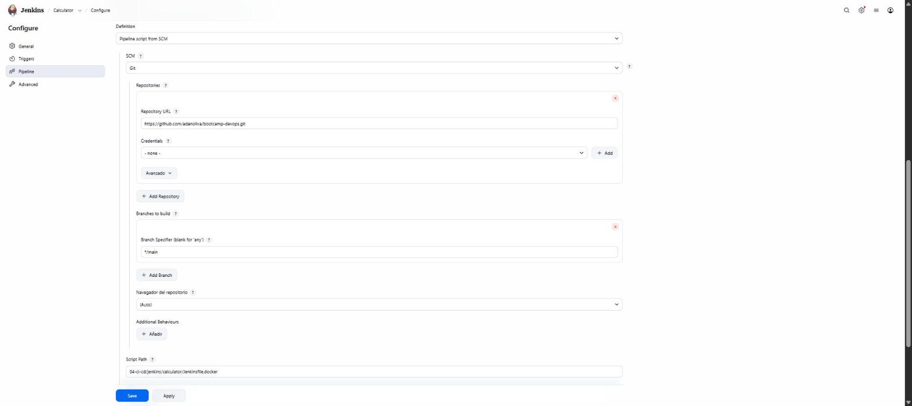

El build #1 sale en verde a la primera:

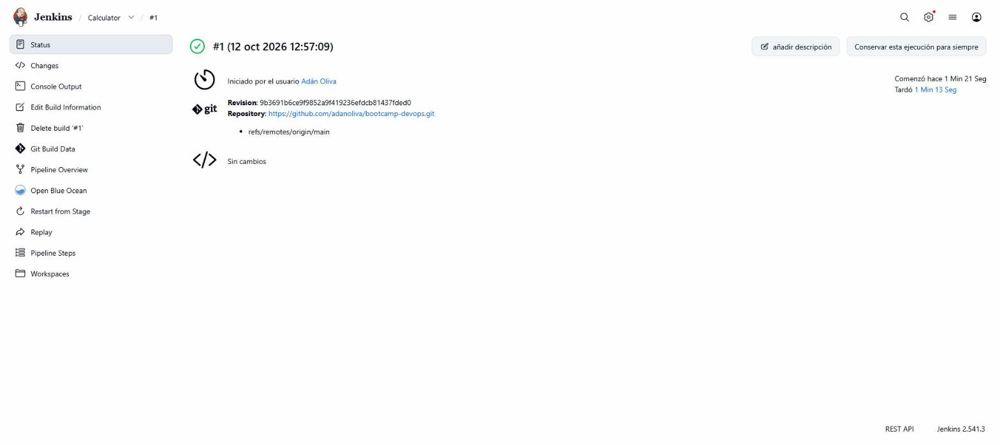

En el log se ve cómo Jenkins le pide la imagen al demonio de DinD, levanta el contenedor con el workspace montado, ejecuta los stages dentro y al final lo para:

```
+ docker inspect -f . gradle:6.6.1-jre14-openj9
error: no such object: gradle:6.6.1-jre14-openj9
+ docker pull gradle:6.6.1-jre14-openj9
Status: Downloaded newer image for gradle:6.6.1-jre14-openj9
Jenkins seems to be running inside container a405bee3e17acd4b7a59e693e8a9d95b54e5bde13372eed8da84ce6f0aea1c77
but /var/jenkins_home/workspace/Calculator could not be found among []
but /var/jenkins_home/workspace/Calculator@tmp could not be found among []
$ docker run -t -d -u 1000:1000 -w /var/jenkins_home/workspace/Calculator -v /var/jenkins_home/workspace/Calculator:/var/jenkins_home/workspace/Calculator:rw,z ...
+ ./gradlew compileJava
Downloading https://services.gradle.org/distributions/gradle-6.6.1-bin.zip
BUILD SUCCESSFUL in 27s
+ ./gradlew test
> Task :compileJava UP-TO-DATE
BUILD SUCCESSFUL in 7s
$ docker stop --time=1 396940cf0def...
Finished: SUCCESS
```

En ese punto se ve que Jenkins está corriendo dentro de un contenedor, con el ID `a405bee3e17a...`, que es `jenkins-blueocean`:

```bash
docker inspect -f '{{.Name}} {{.Id}}' jenkins-blueocean
```
```
/jenkins-blueocean a405bee3e17acd4b7a59e693e8a9d95b54e5bde13372eed8da84ce6f0aea1c77
```

El plugin le pide al demonio los volúmenes de ese contenedor para montar el workspace con `--volumes-from`, pero la lista llega vacía (`among []`) porque el demonio es el de DinD y no conoce a `jenkins-blueocean`. Por eso monta la ruta a mano con `-v`, que funciona porque `jenkins-docker` también tiene `jenkins_home` en la misma ruta. Con el socket del host (DooD) el demonio sí conocería el contenedor y saldría `--volumes-from`.

Esta vez no hay error de Java porque el build ya no usa el Java de Jenkins sino el de la imagen. El `gradlew` se descarga su propia distribución de Gradle aunque la imagen ya lo trae; con `gradle` a secas usaría el de la imagen, pero el enunciado pide `gradlew`.

---

## Ejercicios GitHub Actions

### Ejercicio 1. Workflow CI para el proyecto de frontend - OBLIGATORIO

Copiar el directorio `.start-code/hangman-front` en el directorio raíz del mismo repositorio que se usó en las clases de GitHub Actions (o en uno nuevo). Crear un workflow que se dispare cuando haya cambios en `hangman-front` y exista una nueva pull request (las dos condiciones a la vez).

#### 📋 Requisitos

- [ ] Build del proyecto de front.
- [ ] Ejecutar los unit tests.

#### 🛠️ Resolución

<!-- Pegar aquí los manifiestos/comandos usados y capturas de verificación -->

---

### Ejercicio 2. Workflow CD para el proyecto de frontend - OBLIGATORIO

Crear un workflow que se dispare manualmente.

#### 📋 Requisitos

- [ ] Crear una nueva imagen de Docker.
- [ ] Publicar dicha imagen en el [container registry de GitHub](https://docs.github.com/en/packages/working-with-a-github-packages-registry/working-with-the-container-registry).

#### 🛠️ Resolución

<!-- Pegar aquí los manifiestos/comandos usados y capturas de verificación -->

---

### Ejercicio 3. Workflow que ejecute tests e2e - OPCIONAL

Crear un workflow que se lance de la manera que se elija y ejecute los tests e2e de `.start-code/hangman-e2e/e2e`. Se puede usar [Docker Compose](https://docs.docker.com/compose/gettingstarted/) o [Cypress action](https://github.com/cypress-io/github-action).

Para ejecutar los tests tienen que estar corriendo el front y la api:

```bash
docker run -d -p 3001:3000 hangman-api
docker run -d -p 8080:8080 -e API_URL=http://localhost:3001 hangman-front

cd hangman-e2e/e2e
npm run open
```

#### 📋 Requisitos

- [ ] Levantar `hangman-api` y `hangman-front` en el workflow.
- [ ] Ejecutar los tests e2e.

#### 🛠️ Resolución

<!-- Pegar aquí los manifiestos/comandos usados y capturas de verificación -->

---

### Ejercicio 4. Custom JavaScript Action - OPCIONAL

Crear una custom JavaScript Action que se ejecute cada vez que una issue tenga la etiqueta `motivate` y pinte por consola un mensaje motivacional. Referencia: [crear una JavaScript action](https://docs.github.com/es/actions/creating-actions/creating-a-javascript-action).

```bash
curl https://favqs.com/api/qotd
```

#### 📋 Requisitos

- [ ] Disparar la acción al etiquetar una issue con `motivate`.
- [ ] Obtener una frase de la API y pintarla por consola.

#### 🛠️ Resolución

<!-- Pegar aquí los manifiestos/comandos usados y capturas de verificación -->
